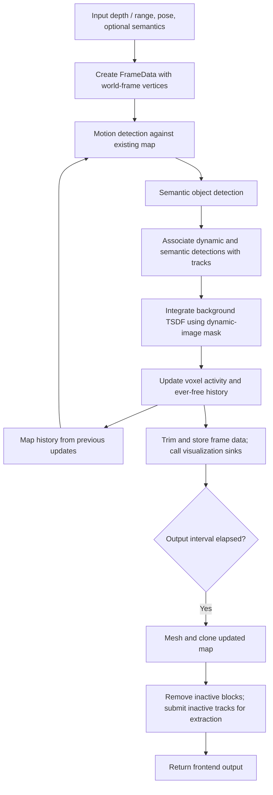

# Motion detection and the active window in Khronos

This guide describes the implementation in this checkout (Khronos commit `c801bb0`) and its local Hydra dependency. Source links are relative to this file; Hydra links point to the sibling `hydra` repository.

## Core idea

Khronos detects motion by finding **current depth points inside voxels previously established as free space**. Those points contradict the map's free-space history, so they become seeds for dynamic-object clusters. This is a geometric occupancy-change detector: it does not compute optical flow or estimate velocity to decide whether an individual point is moving.

The active window owns the volumetric map that provides this history, runs the detector on each processed frame, and uses its output to protect background reconstruction from moving surfaces. It also owns object tracking, frame storage, and extraction of objects when their tracks become inactive.

The main implementation is [FreeSpaceMotionDetector](khronos/src/active_window/motion_detection/free_space_motion_detector.cpp), orchestrated by [ActiveWindow](khronos/src/active_window/active_window.cpp).

## 1. What the active window contains

There are three related but distinct kinds of state:

| State | Purpose | Lifetime control |
| --- | --- | --- |
| Volumetric map: TSDF and tracking layers | Background reconstruction and free-space history | `tracking_integrator.temporal_window`, followed by block archival |
| Object tracks | Associate detections across frames and collect observations | `tracker.temporal_window` |
| Frame-data buffer | Retain inputs and detections for later object extraction | Track references, `max_buffer_size`, and `store_every_n_frames` |

The window is therefore not simply a fixed queue of the last N images, nor a fixed-radius crop around the robot. Visibility and elapsed time govern activity; map storage and removal operate in voxel blocks.

Each Hydra [TrackingVoxel](../hydra/include/hydra/reconstruction/voxel_types.h) holds `first_observed`, `last_observed`, `last_occupied`, `ever_free`, `active`, and `to_remove`. The detector reads `ever_free`; it does **not** check `active` or `to_remove` when choosing seeds.

Khronos's [ActiveWindow::Config](khronos/include/khronos/active_window/active_window.h) enables the tracking layer by default through `hydra::ActiveWindowModule::Config(false, true)`. Keep that layer enabled: the free-space detector dereferences it, and a constructor warning is not a safe fallback if it is absent.

## 2. Exact processing order

For every input processed by `ActiveWindow::spinOnce()`:



`createData()` requests world-frame vertices from Hydra's input conversion and initializes `dynamic_image` and `object_image` to zero. Motion detection therefore compares the current observation against the map **before integrating that observation**. A first frame in an empty map has no existing tracking blocks from which to obtain motion seeds.

`min_output_separation` only throttles the full output stage. Detection, association, TSDF integration, tracking-history updates, and buffering occur before that check. Meshing, physical block removal, and submission of inactive tracks for extraction occur at output times.

Source: [ActiveWindow::spinOnce, createData, updateMap, extractOutputData](khronos/src/active_window/active_window.cpp).

## 3. How free-space history is established

[TrackingIntegrator](khronos/src/active_window/integration/tracking_integrator.cpp) updates history after projective TSDF integration.

### Observation and occupancy

Hydra's [ProjectiveIntegrator::updateVoxel](../hydra/src/reconstruction/projective_integrator.cpp) updates `last_observed` whenever it integrates a valid voxel measurement, and sets `first_observed` when the previous TSDF weight was zero.

Khronos then scans all allocated TSDF blocks. For each voxel:

```text
occupancy_threshold = configured value in meters, if positive
                    = -configured value * voxel_size, if negative

if tsdf.distance < occupancy_threshold:
    last_occupied = current_time

active = last_observed >= current_time - temporal_window
if previously active and now inactive:
    to_remove = true
```

The default threshold is `-1.5`, meaning 1.5 voxel widths; with 0.1 m voxels it is 0.15 m. This is a signed-distance threshold, not an absolute-distance test.

An important implementation detail: occupancy is checked against the stored TSDF even for blocks not updated by the current frame. `last_occupied` is therefore a timestamp derived from the current evaluation of the map, not necessarily the time of a fresh sensor hit. The occupancy branch itself has no TSDF-weight check.

### Promotion to `ever_free`

In blocks marked as updated for tracking by TSDF integration, a voxel can become `ever_free` when:

1. It has been observed: `last_observed != 0`.
2. Its last occupied timestamp is strictly older than `current_time - temporal_buffer`.
3. Every neighbor selected by `tracking_integrator.neighbor_connectivity` either is already `ever_free` or satisfies the same observed-and-free test. A missing neighboring block rejects promotion.

This neighborhood check provides a margin against uncertain surfaces and unobserved space. Its default connectivity is 18.

**`burn_in_period` is declared and configurable, but is not used by the implementation's free-space predicate.** Despite comments describing burn-in, `voxelIsFree()` uses `temporal_buffer`, whose default is 1 s. It also does not explicitly require an observation history of that duration or check `active`.

Once set, `ever_free` is sticky in this path: it is not cleared when the voxel becomes occupied or inactive. Its history disappears when the containing map block is removed. Thus “ever” means within the lifetime of retained map storage, not all time across the complete reconstructed scene.

## 4. From current points to dynamic clusters

`FreeSpaceMotionDetector::processInput()` performs five steps.

### A. Build a voxel-to-pixel map and collect seeds

For each pixel, the detector:

- Rejects ranges `<= 0` or greater than `motion_detector.max_range`.
- Rejects world points below `sensor_world_z + min_z_coordinate`.
- Looks up the existing tracking block containing the world point; missing blocks are skipped.
- Records the pixel under that block and voxel.
- Adds the voxel as a seed if its tracking voxel has `ever_free == true`.

The height filter is a world-Z cutoff relative to sensor height. Although its header describes sensor-frame Z, the implementation does not rotate the point into the sensor frame for this test.

The point map includes eligible non-seed points as well. This lets clustering include nearby surface points that do not themselves contradict free-space history. Image columns are partitioned across worker threads for this stage.

### B. Grow seed-connected clusters

The detector traverses adjacent seed voxels using configurable 6-, 18-, or 26-neighbor connectivity (default: 26). It adds their current pixels to a cluster.

It also includes neighboring non-seed voxels if they contain current eligible points. Those neighbors form a one-voxel fringe: traversal continues through seeds, not recursively through arbitrary non-seed occupied voxels. It therefore does not flood-fill an entire connected scene surface from one seed.

### C. Merge nearby clusters

Two clusters are considered connected if any pair of their voxel indices has Euclidean distance strictly less than `min_separation_distance`. Connected groups of clusters are merged transitively.

The separation is measured in **map voxels**, not meters or image pixels. For 0.1 m map voxels, a setting of 2 corresponds to a strict 0.2 m voxel-index-distance threshold. A setting of 1 does not merge distinct face-adjacent voxel indices merely because they are one voxel apart: the comparison is `<`, not `<=`.

### D. Filter by size

Clusters with pixel counts below `min_cluster_size` or above `max_cluster_size` are discarded. These thresholds count entries in the cluster's pixel list, not unique occupied voxels or physical volume. Filtering follows merging.

### E. Write frame-local results

Surviving clusters populate `FrameData::dynamic_clusters`, with pixels, voxels, a bounding box, and an ID. Their pixels are labeled in `dynamic_image`; zero remains for pixels without an accepted dynamic detection.

These IDs identify detections within a frame, not persistent object tracks. The implementation starts at 1 and caps the ID at 255, so additional clusters share ID 255. The allocated image is nevertheless `CV_32SC1`.

Source: [FreeSpaceMotionDetector implementation](khronos/src/active_window/motion_detection/free_space_motion_detector.cpp) and [configuration defaults](khronos/include/khronos/active_window/motion_detection/free_space_motion_detector.h).

## 5. How detections affect reconstruction and tracking

### Background reconstruction

`ActiveWindow::updateMap()` converts nonzero values of `dynamic_image` into an integration mask, then supplies it to Hydra's projective integrator. Accepted dynamic surface detections are thereby excluded from background integration.

There is a useful nuance: [ProjectiveIntegrator::computeLabel](../hydra/src/reconstruction/projective_integrator.cpp) returns early for measurements outside its configured truncation-band test, before consulting the mask. Thus the mask does not discard an entire ray; free-space measurements outside the surface band can still be integrated. This supports learning free space while suppressing moving surfaces.

Only accepted dynamic clusters contribute to this mask. A candidate removed by cluster-size filtering will not be masked by motion detection. The active-window code has a TODO for semantic masking and currently builds this mask from `dynamic_image` alone.

### Persistent tracks

The example mapper configurations use [MaxIoUTracker](khronos/src/active_window/tracking/max_iou_tracker.cpp), registered as `MaxIouTracker` in YAML. Despite its name, dynamic-to-dynamic association uses greedy nearest-centroid matching with a strict `max_dynamic_distance` gate (default: 1 m), rather than IoU or a velocity prediction. Unmatched dynamic detections create new tracks.

Semantic clusters are subsequently matched to dynamic tracks using `min_cross_iou`, allowing semantic observations to accompany or continue a dynamic track. Remaining semantic detections are associated with static tracks.

With `track_by: voxels`, the tracker recomputes cluster voxel indices using its own `tracker.voxel_size`. That grid can differ from the map grid used for motion detection; the supplied uHumans2 configuration uses 0.2 m tracking voxels and 0.1 m map voxels.

Track activity uses its own clock:

```text
track.is_active = track.last_seen >= current_time - tracker.temporal_window
```

Detection and tracking are optional modules. With no motion detector configured, the fallback does nothing. With a detector but no tracker, detections can still mask the map, but they will not be tracked or extracted as objects.

## 6. What leaving the active window actually means

### Map blocks

Voxel activity is updated every processed frame. A voxel becomes inactive after it has gone longer than `tracking_integrator.temporal_window` without integration, and an active-to-inactive transition sets `to_remove`.

At output time, `extractOutputData()` first generates the mesh and clones updated map blocks into the output. It then calls `TrackingIntegrator::resetInactive()`, which removes a whole block when either:

- `has_active_data` is false (no active voxel remains), or
- every voxel has `to_remove` set.

The implementation does not clear individual inactive voxels in otherwise retained blocks. Consequently, an inactive voxel's `ever_free` flag can still seed a detection while its block survives. The temporal window is an activity threshold, not a strict per-voxel expiration time for free-space evidence. Removal is also delayed until the next output stage.

Once a block is removed, future motion detection cannot query its old free-space history through this local map. A later observation of that region must establish history again unless the block has remained allocated. Archiving its reconstruction downstream is distinct from retaining it in the detector's map.

### Object tracks and frame storage

At output time, inactive tracks are moved into the extraction worker and erased from the tracker. The worker receives a copy of the frame buffer that keeps referenced frame data alive during extraction. Extraction may run asynchronously; completed results are collected into output graph updates.

[FrameDataBuffer](khronos/src/active_window/data/frame_data_buffer.cpp) trims frames no longer referenced by tracks, but also enforces its configured capacity. Therefore a long-lived track does not guarantee that every historical frame remains available.

[MeshObjectExtractor](khronos/src/active_window/object_extraction/mesh_object_extractor.cpp) turns dynamic observations into timestamped trajectory positions and, optionally, visualization points. It can reject tracks whose maximum displacement from their first retained trajectory position is below `min_dynamic_displacement` (1 m in the example configurations). A frame-level dynamic detection therefore does not guarantee an exported dynamic object. Track confidence and extraction filters also matter.

`finishMapping()` forces remaining blocks and tracks inactive and runs output extraction with a wait for extraction workers.

## 7. Parameters to read together

Defaults below are C++ defaults unless an example value is explicitly named.

| Parameter | Default | Effect |
| --- | --- | --- |
| `volumetric_map.voxel_size` | Example: 0.1 m | Resolution for free-space evidence, seed connectivity, and cluster separation |
| `tracking_integrator.tsdf_occupancy_threshold` | -1.5 | Negative values mean multiples of voxel size; distance below threshold counts as occupied |
| `tracking_integrator.temporal_buffer` | 1 s | Required age of `last_occupied` in the actual free-space predicate |
| `tracking_integrator.burn_in_period` | 1 s | Exposed but unused in that predicate |
| `tracking_integrator.neighbor_connectivity` | 18 | Neighborhood that must support free-space promotion |
| `tracking_integrator.temporal_window` | 3 s | Map-voxel inactivity timeout |
| `motion_detector.neighbor_connectivity` | 26 | Connectivity for growing dynamic seed clusters |
| `motion_detector.min_cluster_size` / `max_cluster_size` | 0 / 1,000,000 | Accepted cluster pixel-count range |
| `motion_detector.min_separation_distance` | 1 voxel | Strict proximity threshold for merging clusters |
| `motion_detector.max_range` | 10,000 m | Maximum range considered for motion detection |
| `motion_detector.min_z_coordinate` | -10,000 m | World-Z cutoff offset from sensor height |
| `tracker.max_dynamic_distance` | 1 m | Maximum centroid distance for dynamic association |
| `tracker.temporal_window` | 3 s | Object-track inactivity timeout |
| `min_output_separation` | 0 s | Output/archival/extraction scheduling interval; does not set detection frequency |

The [uHumans2 configuration](khronos_ros/config/mapper/uHumans2.yaml) shares a 3 s YAML anchor between the two temporal windows, but they remain separate parameters and mechanisms. It sets minimum cluster size to 500 pixels, separation to 2 voxels, maximum detection range to 5 m, and output separation to 0.4 s.

The [Jackal configuration](khronos_ros/config/mapper/jackal.yaml) instead sets minimum cluster size to 50,000 pixels and separation to 50 voxels. Those are substantially different acceptance/merging settings; use the actual loaded YAML when diagnosing behavior rather than assuming the uHumans2 values apply.

## 8. Example and practical consequences

Suppose the sensor observes an empty corridor and the relevant voxels and their neighbors satisfy the free-space checks. Their `ever_free` flags become true. On a later frame, a person enters that space:

1. The person's depth returns land in retained ever-free voxels and create seeds.
2. Adjacent seeds and their occupied fringe form clusters; merging and pixel-count filtering determine which survive.
3. Surviving pixels are marked dynamic, associated with tracks, and masked near the surface during background integration.
4. After the person is no longer detected or associated through semantics for the track timeout, the track becomes inactive and is submitted for extraction at an output stage.

Consequences of the implementation:

- **New or unobserved space is a blind spot for this cue.** Motion can be missed when the destination has no established free-space history.
- **A stopped object can remain detectable.** Its surface may still contradict sticky ever-free history; the detector does not require nonzero instantaneous velocity.
- **An object initially present may need to move into known free space to trigger.** Being a potentially movable semantic class alone does not create free-space seeds.
- **Pose/depth errors can mimic motion.** The comparison uses world-frame points; misregistration can place static surfaces inside previously free voxels.
- **Window size affects history retention indirectly.** A shorter map timeout can remove useful history sooner, subject to block retention and output timing. A longer track timeout instead allows longer gaps before track extraction.
- **Small detections may disappear before masking.** Check pixel thresholds before attributing missing output to the tracker or object extractor.

For code navigation, start with `ActiveWindow::spinOnce()`, then read `TrackingIntegrator::voxelIsFree()` and `updateBlockEverFree()`, followed by `FreeSpaceMotionDetector::processInput()`. Return to `updateMap()` and `extractOutputData()` to see how the detector participates in the active-window lifecycle.
